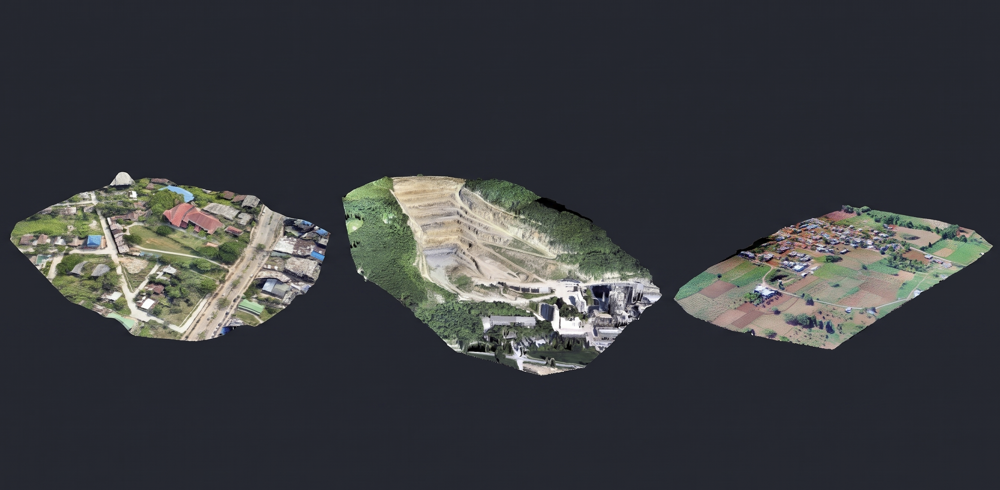
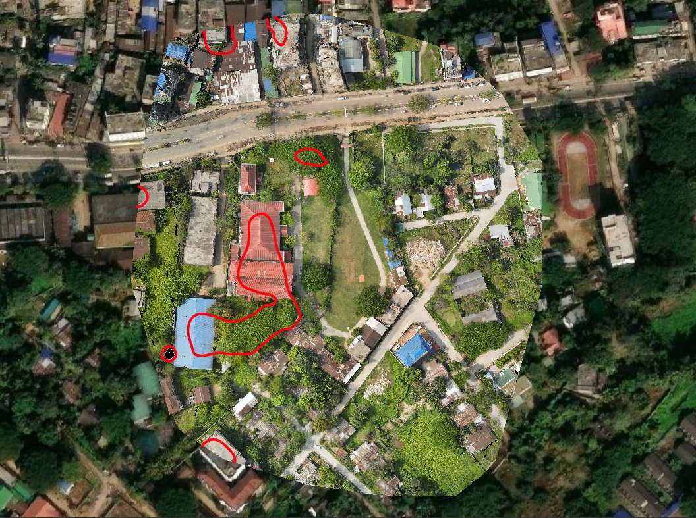
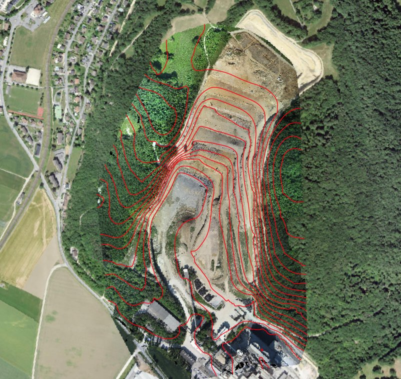
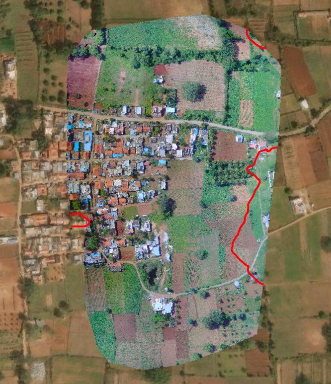
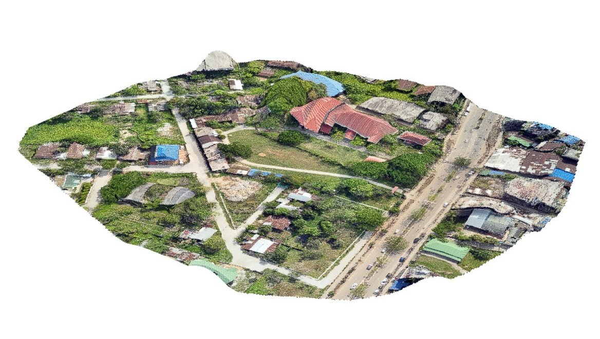
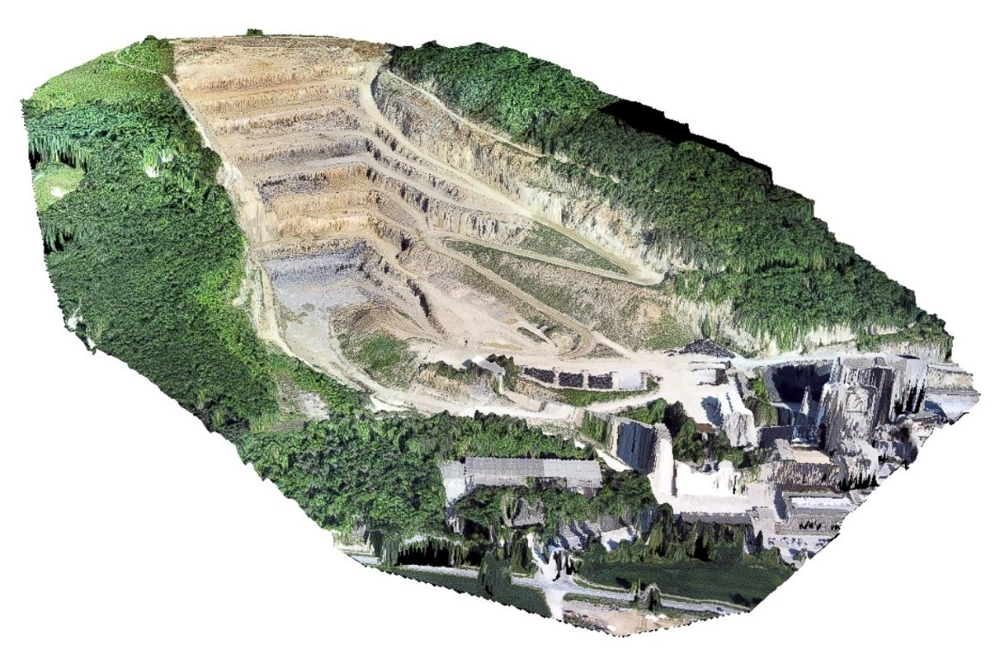
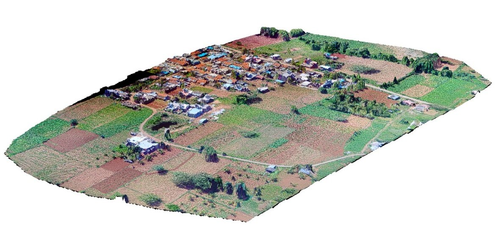

# Drone Processing

## Overview

I processed overlapping drone images of three very different landscapes in Pix4D, an urban neighbourhood in Assam, an open-pit mine in Switzerland and a village in Karnataka. For each area I generated a Point Cloud, Orthomosaic, Digital Surface Model (DSM), Digital Terrain Model (DTM) and Contours. The orthomosaics were then draped over the terrain in ArcScene for 3D visualisation.

**Study Areas:** Urban area (Panjabari, Assam), mining area (Switzerland), village area (Karnataka)  
**Completed:** August 2026  
**Context:** PG Diploma in Geoinformatics, Accelcraft Institute of Geoinformatics Technology  
**Role:** Solo project  
**Status:** Completed

---

## Methods & Tools

**Data Sources**

- Overlapping drone (UAV) image sets for three areas of interest (AOIs)
- Esri satellite imagery as the QGIS basemap for checking the outputs

**Processing Steps**

1. Imported the drone images for each AOI into a new Pix4D project.
2. Aligned and calibrated the images using Structure from Motion (SfM), which reconstructs the terrain from overlapping photographs.
3. Generated a dense Point Cloud for each area.
4. Produced the DSM (surface including trees and buildings), the DTM (bare earth) and the Orthomosaic.
5. Derived Contours from the DTM.
6. Overlaid the orthomosaic and contours on the Esri satellite basemap in QGIS to check alignment.
7. Draped each orthomosaic over its terrain in ArcScene for 3D visualisation.

**Tools Used**

| Tool | Purpose |
|------|---------|
| Pix4D | Image alignment, Point Cloud, Orthomosaic, DSM, DTM and Contours |
| QGIS | Overlaying orthomosaics and contours on the Esri satellite basemap |
| ArcScene | 3D visualisation of the orthomosaics |
| Agisoft Metashape | Studied as an alternative photogrammetry workflow (alignment, dense cloud, mesh, texture) |

---

## Outputs

| Output | What it shows | Typical uses |
|--------|---------------|--------------|
| Point Cloud | Millions of 3D (X, Y, Z) points describing terrain, vegetation and buildings | Terrain analysis, 3D visualisation, volume calculation |
| Orthomosaic | Geometrically corrected, stitched aerial map | Land cover mapping, urban planning, infrastructure monitoring |
| DSM | Elevation of the surface including trees and buildings | Building heights, flood modelling, line-of-sight analysis |
| DTM | Bare-earth elevation | Watershed analysis, slope, hydrological modelling |
| Contours | Lines of equal elevation derived from the DTM | Topographic mapping, route planning, engineering surveys |

### Orthomosaics with Contours (QGIS)

*Urban area, Panjabari, Assam*

*Mining area, Switzerland. Dense contour lines trace the terraced pit walls.*

*Village area, Karnataka*

### 3D Visualisation (ArcScene)

*Urban area, Panjabari, Assam*

*Mining area, Switzerland*

*Village area, Karnataka*

---

## Key Findings

- Pix4D produced a full set of outputs (Point Cloud, Orthomosaic, DSM, DTM and Contours) for all three areas, even though they differ in terrain and land use.
- The **mining area** shows the clearest relief. Tightly spaced contours follow the stepped benches of the pit, and the 3D view makes the benches easy to see.
- The **urban** and **village** areas are gentler, so their contours are sparse. Their orthomosaics are most useful for mapping buildings, roads and land use.
- Draping the orthomosaics in ArcScene turns flat maps into models that are easier to interpret and present.
- The same outputs support surveying, mining volume estimates, hydrology and urban planning.
- Limitations: positional accuracy depends on georeferencing, and adding Ground Control Points (GCPs) would improve it. Future work could compare Pix4D against Agisoft Metashape on the same image sets and calculate stockpile or pit volumes for the mine.