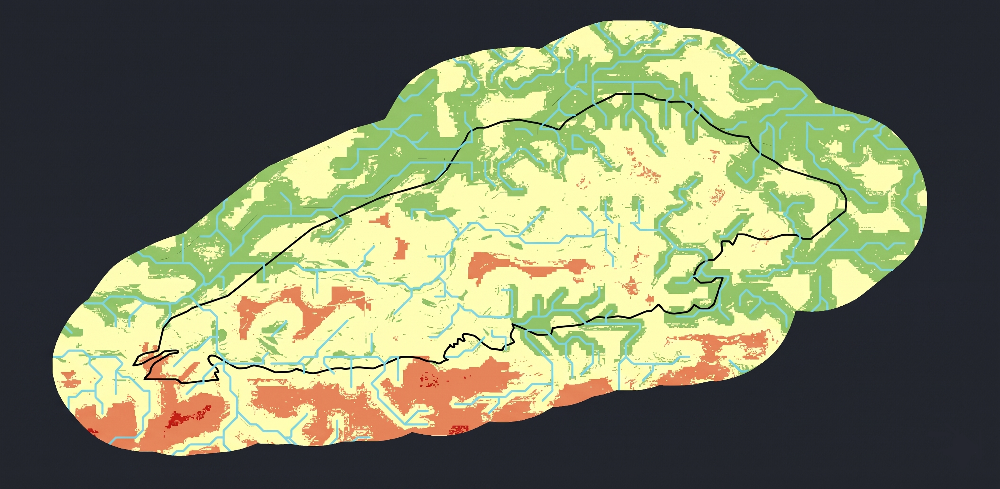

# Flood Susceptibility Mapping of Kaziranga National Park Using Weighted Overlay Analysis

## Overview

I mapped flood susceptibility in Kaziranga National Park, a UNESCO World Heritage Site on the Brahmaputra floodplain, using a GIS-based multi-criteria Weighted Overlay Analysis. I combined six terrain, hydrological, climatic and land cover layers from 2017 into a single susceptibility index. The map can help with flood preparedness and wildlife protection planning in the park.

**Study Area:** Kaziranga National Park, Assam, India (~431.83 km²)  
**Duration:** March 2026 – March 2026 (16 March – 30 March)  
**Role:** Solo project  
**Status:** Completed

---

## Methods & Tools

**Data Sources**

- Park boundary: World Database on Protected Areas (WDPA) via Protected Planet
- Elevation: SRTM DEM (30 m) via Google Earth Engine
- Land cover: Landsat 8 Level-2, Collection 2, Tier 1 surface reflectance (2017) via Google Earth Engine
- Rainfall: CHIRPS daily precipitation, aggregated to 2017 annual totals in Google Earth Engine
- River network: HydroRIVERS (HydroSHEDS)

**Processing Steps**

1. Filled voids and sinks in the DEM, then derived slope and flow accumulation.
2. Clipped all layers to the park boundary, projected them to WGS 84 / UTM Zone 46N, and resampled them to a common 30 m grid.
3. Classified Landsat 8 imagery into five land cover classes: water body, dense forest, agriculture, sandbar and grassland.
4. Reclassified every layer to a 1–5 susceptibility scale. Low elevation, gentle slope and short distance to rivers score high. High flow accumulation and high rainfall also score high.
5. Assigned influence weights (summing to 100%) and ran the Weighted Overlay in ArcMap using FSI = Σ(Wᵢ × Xᵢ).
6. Classified the output into Low, Moderate, High and Very High zones and calculated the area of each.

**Layer Weights**

| Layer | Influence |
|-------|-----------|
| Euclidean Distance from River | 25% |
| Flow Accumulation | 20% |
| Annual Rainfall | 20% |
| Land Use / Land Cover | 15% |
| Digital Elevation Model | 10% |
| Slope | 10% |

**Tools Used**

| Tool | Purpose |
|------|---------|
| ArcMap 10.8 (Spatial Analyst) | Terrain derivatives, Euclidean distance, reclassification and Weighted Overlay |
| Google Earth Engine | Accessing SRTM and Landsat 8, and aggregating CHIRPS rainfall |
| HydroSHEDS / HydroRIVERS | River network for distance and stream analysis |

---

## Key Findings

- **70.73%** of the park (305.41 km²) falls in the **Moderate** susceptibility class.
- **24.19%** (104.45 km²) falls in the **High** class, concentrated in low-lying areas and along river channels.
- **Low** susceptibility covers 21.94 km² (5.08%), and **Very High** only 0.03 km² (0.01%).
- Elevation across the study extent ranges from 52 m to 785 m, and 2017 annual rainfall from about 2,110 to 2,760 mm.
- Terrain is mostly low and gentle-sloped, and the river network is dense. This explains why most of the park falls in the Moderate to High classes.
- Limitations: the model used a 30 m DEM and single-year rainfall, and it has no quantitative validation against historical flood extents. Future work could add Sentinel-1 SAR validation, AHP-based weights and machine learning models.

---

## Links

[View Code on GitHub](https://github.com/hemungshewborgohain7777/Weighted-Overlay-Analysis){ .md-button }
[View Data Source](https://www.hydrosheds.org/){ .md-button }