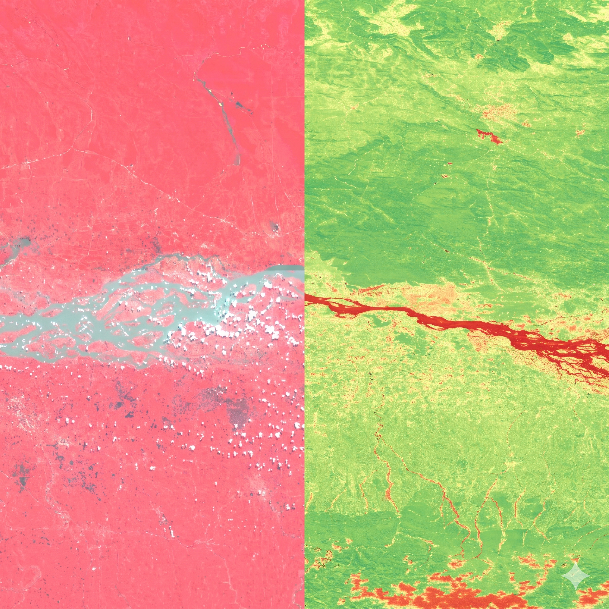
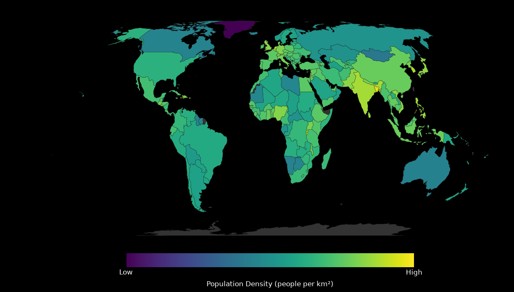
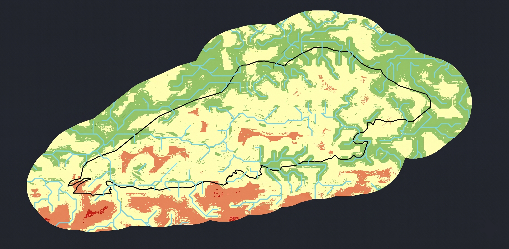
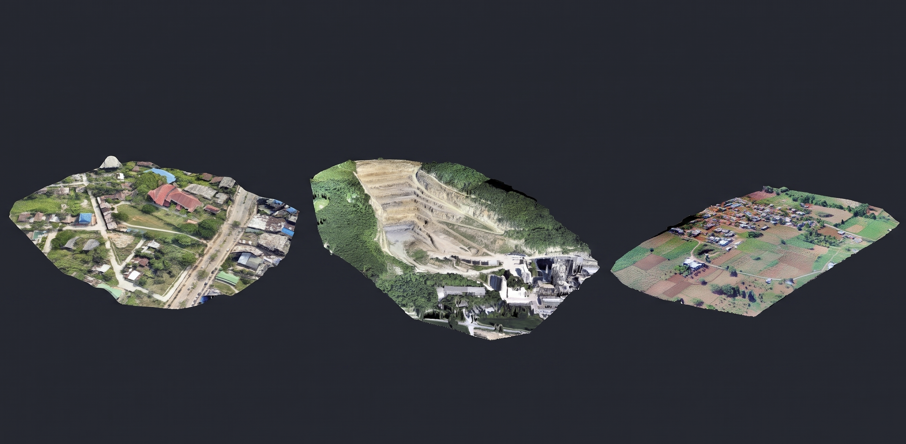

---
hide:
  - toc
  - navigation
---
<!--
CHECKLIST FOR THIS PAGE:
- [ ] Replace the two placeholder cards (marked [YOUR PROJECT ...]) with your real projects
- [ ] For each project: add a thumbnail image to docs/assets/images/ and update the path below
- [ ] For each project: create a project page by copying sample-project.md
- [ ] For each project: add a nav entry in mkdocs.yml (see the comments there)
- [ ] Delete placeholder cards you don't need yet
-->

# Projects

A selection of my geospatial projects. Click any card to see the full write-up.

**[Cloud-Native Sentinel-2 Workflow: Guwahati](Cloud-Native-Sentinel2.md)**

A cloud-native Earth observation pipeline for Guwahati, Assam. Sentinel-2 scenes were found through a STAC API, loaded lazily into an Xarray data cube, stored as Zarr, and used to derive a false-colour composite and NDVI vegetation map.

`STAC` `Xarray` `Zarr` `Sentinel-2` `NDVI` `Python`

[View Project →](Cloud_Native_Sentinel2_Guwahati.ipynb){ .md-button }

**[World Population Mapping](World_Population_Mapping.ipynb)**

Mapped 2024 country-level population and population density worldwide by joining World Bank population data to world country boundaries. The density map on a logarithmic scale shows that Malta and Bangladesh are the most densely populated countries.

`jupyter` `geopandas` `pandas` `matplotlib` `request`

[View Project →](World_Population_Mapping.ipynb){ .md-button }

**[Flood Susceptibility Mapping of Kaziranga National Park](Flood-Susceptibility.md)**

A GIS-based Weighted Overlay Analysis of flood susceptibility in Kaziranga National Park, Assam. Six terrain, hydrological, climatic and land cover layers from 2017 were combined into a single index and classified into four susceptibility zones.

`Weighted Overlay` `ArcMap` `Google Earth Engine` `Flood Mapping`

[View Project →](Flood-Susceptibility.md){ .md-button }

**[Drone Processing](Drone-Processing.md)**

[YOUR PROJECT DESCRIPTION — one or two sentences: what you did, what data you used,
and what you found or built.]

`Pix4D` `Digital Surface Model` `3D Visualisation`

[View Project →](Drone-Processing.md){ .md-button }

<!-- mkdocs serve --livereload -->